

**ĐẠI HỌC QUỐC GIA TP. HỒ CHÍ MINH** 
**TRƯỜNG ĐẠI HỌC BÁCH KHOA — KHOA KHOA HỌC VÀ KỸ THUẬT MÁY TÍNH**

  

# BÁO CÁO BÀI TẬP LỚN MÔN HỌC MÁY

**Bài 1: Học máy với dữ liệu dạng bảng** 
**Dự đoán khách hàng rời bỏ nhà mạng (Telecom Customer Churn)**

 

Học kỳ I — Năm học 2026–2027 · Mã môn học: `<MÃ MÔN>` 
Giảng viên hướng dẫn: `<Họ tên GVHD>`

 

| Họ và tên | MSSV | Email |
|---|---|---|
| `<Thành viên 1>` | `<MSSV>` | `<email>` |
| `<Thành viên 2>` | `<MSSV>` | `<email>` |
| `<Thành viên 3>` | `<MSSV>` | `<email>` |

 

Mã nguồn: https://github.com/Kunneaa/Churn-Prediction 
Colab: https://colab.research.google.com/github/Kunneaa/Churn-Prediction/blob/main/notebooks/01-churn-pipeline.ipynb

## 1. Giới thiệu và mục tiêu

Bài toán: dự đoán một khách hàng viễn thông có **rời bỏ nhà mạng** (`churn = 1`) hay không, từ dữ liệu sử dụng dịch vụ,
cước, thiết bị và nhân khẩu học — phân loại nhị phân trên dữ liệu dạng bảng.

Mục tiêu theo đề bài:
- Xây dựng **pipeline học máy truyền thống cấu hình được**: EDA → tiền xử lý (làm sạch, imputation, encoding, scaling) →
  trích xuất và lựa chọn đặc trưng (feature engineering, chọn đặc trưng, PCA) → huấn luyện → đánh giá.
- **So sánh nhiều cấu hình** ở từng bước, giải thích kết quả, phân tích ưu điểm và hạn chế.
- Mở rộng (điểm cộng): **pipeline học sâu** (MLP) so sánh với pipeline truyền thống.
- Sản phẩm: notebook Google Colab chạy được bằng *Runtime → Run all*, package `modules/`, đặc trưng `.npy` trong `features/`,
  bảng và hình trong `reports/`.

**Nguyên tắc đánh giá.** Mọi lựa chọn (tiền xử lý, mô hình, siêu tham số, ngưỡng phân loại) chỉ dựa trên
**cross-validation trên tập train**. Tập test (20%) được giữ riêng và chỉ dùng **một lần** ở bước đánh giá cuối.

## 2. Dữ liệu

| | |
|---|---|
| Tên | Telecom Customer Churn (Teradata Center for CRM, Duke University) |
| Nguồn công khai | https://www.kaggle.com/datasets/abhinav89/telecom-customer (tải không cần đăng nhập) |
| Kích thước | 100.000 khách hàng × 100 cột (78 cột số, 21 cột phân loại, nhãn `churn`); không có dòng trùng |
| Nhãn | `churn` — 49,6% khách hàng rời bỏ (gần cân bằng) |
| Giá trị thiếu | 43 cột có `NaN` (từ 1 dòng đến 49,4% số dòng) cùng các mã unknown ẩn |
| Biến phân loại | 21 cột; `crclscod` (hạng tín dụng) có 54 giá trị |

Dữ liệu thoả các ràng buộc của đề: **có giá trị thiếu** (để thực hành imputation), **có biến phân loại** (để thực hành
encoding), và số mẫu lớn (100.000).

## 3. Phân tích khám phá dữ liệu (EDA)

### 3.1 Phân phối nhãn

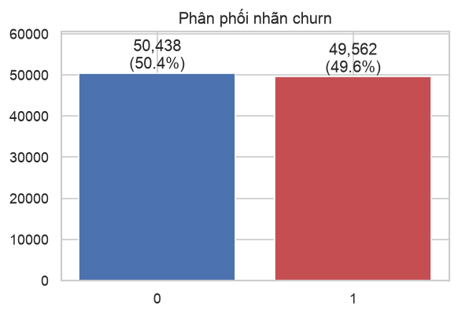

Nhãn gần cân bằng (49,6% churn) ⇒ accuracy có ý nghĩa, nhưng **ROC-AUC** được dùng làm chỉ số chính vì không phụ thuộc
ngưỡng. Một hệ quả quan trọng (mục 7.2): với tỷ lệ này, chiến lược tầm thường "đoán churn cho tất cả" đã có F1 = 0,663.

### 3.2 Giá trị thiếu

Dữ liệu có ba loại giá trị thiếu:
1. **Thiếu tường minh** (`NaN`) — chủ yếu ở các cột nhân khẩu học (`numbcars`, `dwllsize`, `HHstatin`, `ownrent`, `income`, …).
2. **Thiếu ẩn**: mã `"U"` (unknown) trong `new_cell`, `marital`, `ethnic`, `dualband`; `"UNKW"` trong `hnd_webcap`;
   `eqpdays < 0` (số ngày dùng thiết bị không thể âm). Lưu ý `"U"` trong `prizm_social_one` nghĩa là *Urban* — **không**
   phải giá trị thiếu; phải đọc data dictionary trước khi xử lý.
3. **Thiếu có cấu trúc**: `avg6mou`, `avg6qty`, `avg6rev` (trung bình 6 tháng) thiếu ở mọi khách hàng mới dùng đúng 6 tháng.

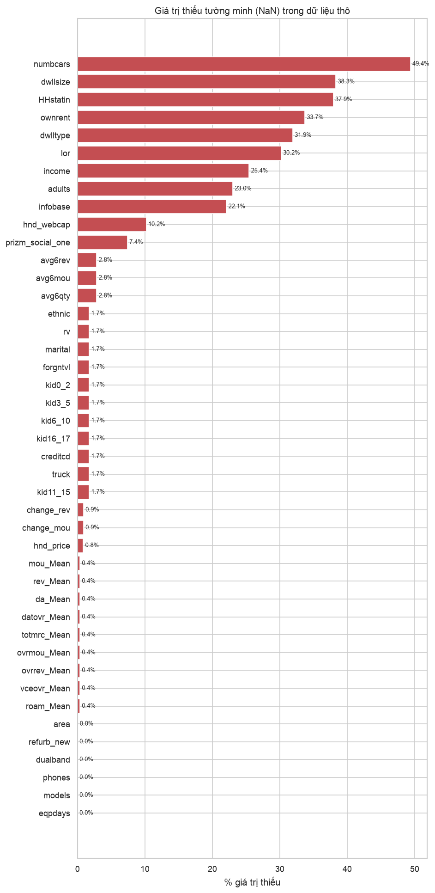

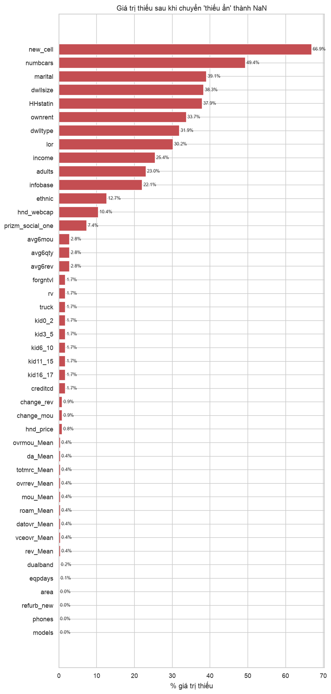

Tỷ lệ dòng có ít nhất một giá trị thiếu tăng từ **73,3%** lên **93,0%** sau khi đổi thiếu ẩn thành `NaN` — không thể bỏ
dòng, bắt buộc phải impute. Việc thiếu **mang thông tin về churn**: khách thiếu `hnd_webcap` churn 58,6% (so với 48,5%),
khách thiếu `avg6*` churn chỉ 40,2% ⇒ dùng imputation **kèm cờ thiếu** (`add_missing_indicator`), kiểm chứng ở mục 5.1.

### 3.3 Biến số: phân phối, độ lệch, ngoại lai

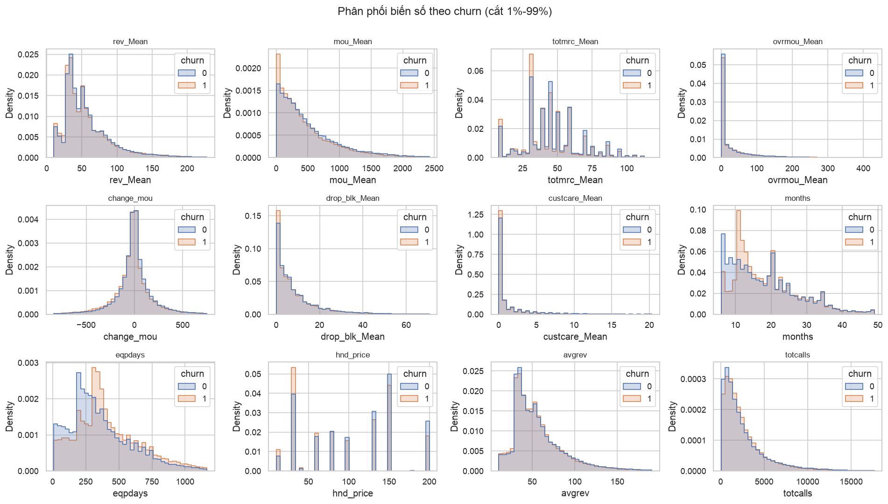

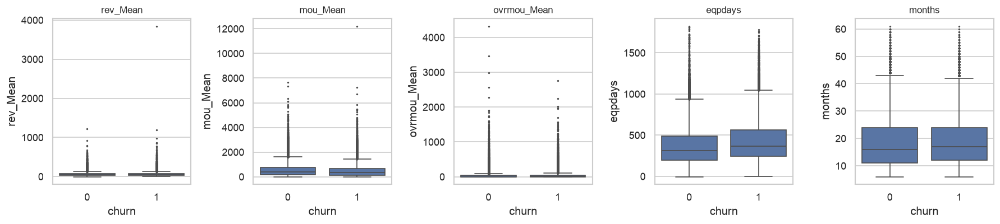

Các biến sử dụng/cước lệch phải rất mạnh (skew của `change_rev` 80, `roam_Mean` 169) và có 10–26% ngoại lai theo IQR. Ngoại
lai là hành vi thật (khách dùng nhiều), không phải lỗi nhập, nên **không xoá** mà giảm ảnh hưởng bằng biến đổi `log1p` giữ
dấu hoặc dùng mô hình cây (không nhạy với thang đo).

### 3.4 Biến phân loại

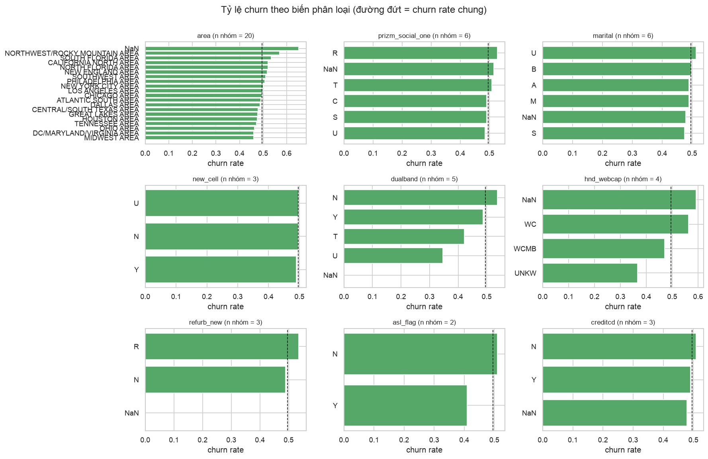

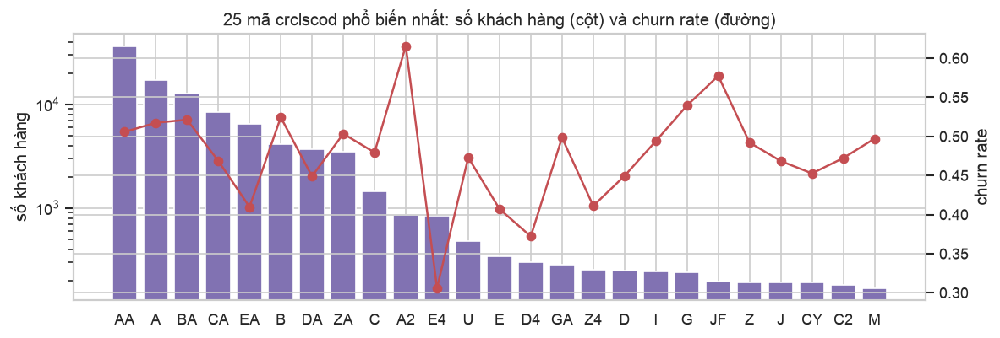

`crclscod` có 54 mã, 13 mã có dưới 20 khách hàng, churn rate giữa các mã phổ biến dao động 31%–62% ⇒ cột có thông tin
nhưng one-hot sẽ sinh nhiều cột hiếm; so sánh frequency / target / one-hot (gộp mã hiếm) / bỏ cột ở mục 5.2.

### 3.5 Tương quan

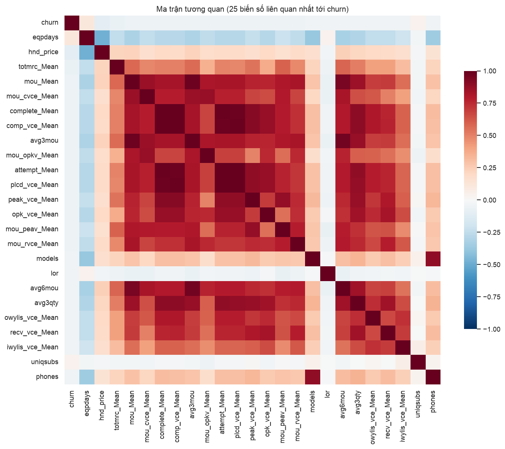

Không biến nào tương quan tuyến tính mạnh với churn (|r| lớn nhất 0,11 — `eqpdays`, tiếp theo `hnd_price` −0,10) ⇒ bài
toán khó, quan hệ phi tuyến; dự kiến mô hình cây vượt mô hình tuyến tính. 104 cặp biến có |r| ≥ 0,8 (vd. `totcalls`–`adjqty`
= 1,00) ⇒ đa cộng tuyến mạnh: cần regularization cho Logistic Regression; PCA có thể nén nhiều chiều.

## 4. Pipeline học máy cấu hình được

### 4.1 Kiến trúc

Pipeline gồm các bước nối tiếp trong một `sklearn.Pipeline` (bước trong ngoặc là tuỳ chọn):

| # | Bước | Thành phần | Lựa chọn |
|---|---|---|---|
| 1 | Feature engineering | `FeatureEngineer` | 17 tỷ lệ/xu hướng + `credit_class` |
| 2a | Cột số | Imputer (+ cờ thiếu) → (log1p giữ dấu) | median / mean / most_frequent / knn |
| 2b | Cột phân loại | Imputer → Encoder | one-hot / ordinal |
| 2c | `crclscod` (54 mã) | Imputer → Encoder | frequency / target / one-hot / bỏ cột |
| 3 | Scaling | Scaler | standard / minmax (`feature_range`) / none |
| 4 | (Chọn đặc trưng) | Selector | ANOVA F / mutual information / L1 |
| 5 | (Giảm chiều) | PCA | giữ 90% / 95% / 99% phương sai |
| 6 | Mô hình | Classifier | Dummy, LR, Linear SVM, k-NN, Naive Bayes, RF, HistGB, LightGBM, MLP, MLP PyTorch |

- **Làm sạch** (theo từng dòng, không học tham số nên không rò rỉ): bỏ `Customer_ID`, đổi mã thiếu ẩn thành `NaN`.
- **Chia train/test**: stratified 80/20, `random_state = 42` (80.000 / 20.000 dòng, cùng tỷ lệ churn 49,6%).
- **Feature engineering** (`modules/featurize`): 17 đặc trưng tỷ lệ/xu hướng theo nghiệp vụ — cước trên phút, tỷ lệ phút
  vượt gói, tỷ lệ cuộc gọi rớt/chặn, xu hướng phút gọi và cước (3 tháng so với 6 tháng, so với trung bình đời thuê bao),
  tỷ lệ gọi chăm sóc khách hàng, tuổi máy so với tuổi thuê bao, … — và `credit_class` (chữ cái đầu của `crclscod`).
- **Chống rò rỉ dữ liệu**: mọi bước học tham số (imputer, encoder, scaler, chọn đặc trưng, PCA, mô hình) nằm trong **một
  `sklearn.Pipeline`**, nên khi cross-validation chúng chỉ được fit trên phần train của từng fold. TargetEncoder dùng
  cross-fitting nội bộ.

### 4.2 Tham số cấu hình

Mỗi thí nghiệm là một `PipelineConfig` (`modules/modeling/config.py`); mọi lựa chọn đều là tham số:

| Bước | Tham số | Lựa chọn |
|---|---|---|
| Làm sạch | `treat_hidden_missing` | có / không đổi mã thiếu ẩn thành NaN |
| Imputation | `num_imputer`, `cat_imputer`, `add_missing_indicator` | median / mean / most_frequent / knn; most_frequent / constant; có / không cờ thiếu |
| Encoding | `cat_encoder`, `high_card_encoder` | onehot / ordinal; frequency / target / onehot / drop |
| Biến đổi | `log_transform` | sign(x)·log(1+\|x\|) hoặc không |
| Scaling | `scaler`, `minmax_range` | standard / minmax (cấu hình `feature_range`) / none |
| Chọn đặc trưng | `feature_selection`, `selection_k`, `selection_c` | không / SelectKBest (ANOVA F, mutual information) / L1 |
| Giảm chiều | `pca_variance` | không / 0.90 / 0.95 / 0.99 |
| Mô hình | `model`, `model_params`, `class_weight` | dummy, logreg, linear_svm, knn, naive_bayes, random_forest, hist_gb, lightgbm, mlp, torch_mlp |

Tham số thí nghiệm (số fold, kích thước mẫu con, không gian tuning, kiến trúc MLP) nằm trong `configs/default.yaml`.

### 4.3 Giao thức thí nghiệm

- Mỗi giai đoạn đổi **một bước** của pipeline, giữ nguyên các bước còn lại; đánh giá bằng **stratified 3-fold CV** trên mẫu
  con phân tầng **30.000 dòng của tập train** (để notebook chạy được trên Colab 2 CPU). Mô hình dùng cho 5.1–5.5: Logistic
  Regression (nhanh, nhạy với tiền xử lý).
- **Quy tắc chọn một sai số chuẩn**: phương án được xếp từ đơn giản tới phức tạp; chọn phương án **đầu tiên** có CV ROC-AUC
  không kém phương án cao nhất quá một sai số chuẩn (độ lệch chuẩn giữa các fold / √3). Cấu hình được chọn mang sang giai
  đoạn sau.
- **Kiểm định thống kê** (5.7): CV 3-fold lặp 3 lần trên cùng các fold, t-test ghép cặp **hiệu chỉnh Nadeau–Bengio**
  (phương sai nhân (1/k + n_test/n_train)) vì các fold dùng chung dữ liệu train.
- Chỉ số: ROC-AUC (chính), PR-AUC, Accuracy, Precision, Recall, F1.

## 5. Thí nghiệm so sánh cấu hình

### 5.1 Xử lý giá trị thiếu

| Cấu hình | CV ROC-AUC ± std | CV PR-AUC | CV F1 | CV Accuracy |
|---|---|---|---|---|
| median + indicator | 0.6344 ± 0.0027 | 0.6172 | 0.5904 | 0.5962 |
| mean + indicator | 0.6343 ± 0.0027 | 0.6171 | 0.5902 | 0.5961 |
| most_frequent + indicator | 0.6343 ± 0.0027 | 0.617 | 0.5904 | 0.5961 |
| median, no indicator | 0.6269 ± 0.0019 | 0.6054 | 0.5894 | 0.5917 |
| median + cat='Missing' | 0.6353 ± 0.0024 | 0.6177 | 0.5906 | 0.5965 |
| không xử lý thiếu ẩn | 0.6345 ± 0.0025 | 0.6172 | 0.5903 | 0.5958 |

Bỏ cờ thiếu làm ROC-AUC giảm rõ nhất (0,6344 → 0,6269), khớp EDA. Mean / median / most_frequent không khác nhau. Điền
`"Missing"` cho cột phân loại cao nhất nhưng chỉ hơn 0,0009 (< một sai số chuẩn ≈ 0,0014) ⇒ chọn **median + cờ thiếu**.
Đổi hay không đổi mã thiếu ẩn thành NaN gần như như nhau với Logistic Regression. KNNImputer có trong pipeline nhưng không
đưa vào so sánh vì ~93% dòng có giá trị thiếu, chi phí tính khoảng cách quá lớn cho Colab.

### 5.2 Mã hoá biến phân loại

| Cấu hình | CV ROC-AUC ± std | CV PR-AUC | CV F1 | CV Accuracy |
|---|---|---|---|---|
| cat=onehot \| crclscod=frequency | 0.6344 ± 0.0027 | 0.6172 | 0.5904 | 0.5962 |
| cat=onehot \| crclscod=target | 0.6345 ± 0.0030 | 0.6172 | 0.5903 | 0.5964 |
| cat=onehot \| crclscod=onehot | 0.6344 ± 0.0026 | 0.617 | 0.5906 | 0.5963 |
| cat=onehot \| crclscod=drop | 0.6344 ± 0.0028 | 0.6172 | 0.59 | 0.5961 |
| cat=ordinal \| crclscod=frequency | 0.6339 ± 0.0033 | 0.6171 | 0.591 | 0.5972 |
| cat=ordinal \| crclscod=target | 0.6352 ± 0.0042 | 0.6181 | 0.5908 | 0.5971 |
| cat=ordinal \| crclscod=onehot | 0.6347 ± 0.0043 | 0.6178 | 0.5914 | 0.5966 |
| cat=ordinal \| crclscod=drop | 0.6339 ± 0.0032 | 0.617 | 0.5915 | 0.5977 |

Mọi cách encoding nằm trong khoảng 0,6339–0,6352, chênh lệch nhỏ hơn độ lệch chuẩn ⇒ encoding không phải nút thắt (kiểm
định: p = 0,80). Theo quy tắc chọn, giữ **one-hot + frequency cho `crclscod`** — one-hot đúng bản chất biến định danh (không
áp đặt thứ tự giả như ordinal), frequency chỉ thêm 1 cột cho 54 mã. Bỏ hẳn `crclscod` không mất gì vì `credit_class` giữ
phần lớn thông tin.

### 5.3 Scaling và biến đổi log

| Cấu hình | CV ROC-AUC ± std | CV PR-AUC | CV F1 | CV Accuracy |
|---|---|---|---|---|
| logreg \| none | 0.6108 ± 0.0057 | 0.5848 | 0.5714 | 0.5812 |
| logreg \| standard | 0.6344 ± 0.0027 | 0.6172 | 0.5904 | 0.5962 |
| logreg \| minmax(0.0, 1.0) | 0.6342 ± 0.0031 | 0.6189 | 0.5877 | 0.5946 |
| logreg \| minmax(-1.0, 1.0) | 0.6344 ± 0.0029 | 0.6182 | 0.5904 | 0.5967 |
| logreg \| log + standard | 0.6433 ± 0.0018 | 0.6301 | 0.5939 | 0.6017 |
| logreg \| log + minmax(0.0, 1.0) | 0.6422 ± 0.0029 | 0.6297 | 0.5922 | 0.6006 |
| knn \| none | 0.5646 ± 0.0057 | 0.5509 | 0.5272 | 0.5457 |
| knn \| standard | 0.5716 ± 0.0046 | 0.5667 | 0.5072 | 0.548 |
| knn \| minmax(0.0, 1.0) | 0.5488 ± 0.0012 | 0.5456 | 0.5043 | 0.5367 |
| knn \| minmax(-1.0, 1.0) | 0.5488 ± 0.0012 | 0.5456 | 0.5043 | 0.5367 |
| knn \| log + standard | 0.5776 ± 0.0059 | 0.5731 | 0.5193 | 0.5546 |
| knn \| log + minmax(0.0, 1.0) | 0.5652 ± 0.0034 | 0.5621 | 0.5069 | 0.5468 |

Đây là bước tiền xử lý tác động lớn nhất. Logistic Regression không scale chỉ đạt 0,6108 và bộ tối ưu lbfgs không hội tụ;
StandardScaler / MinMax ≈ 0,634; **log1p + StandardScaler 0,6433** (+0,009, kiểm định p = 0,001) vì log thu hẹp ngoại lai.
`feature_range` (0, 1) hay (−1, 1) không đổi kết quả (MinMax chỉ dịch/giãn tuyến tính). k-NN kém xa ở mọi cách scale
(khoảng cách Euclid trên ~230 chiều nhiễu).

### 5.4 Giảm số chiều bằng PCA

| Cấu hình | Số đặc trưng | CV ROC-AUC ± std | CV PR-AUC | CV F1 | CV Accuracy |
|---|---|---|---|---|---|
| logreg \| PCA=None | 231 | 0.6433 ± 0.0018 | 0.6301 | 0.5939 | 0.6017 |
| logreg \| PCA=0.9 | 105 | 0.6278 ± 0.0033 | 0.6167 | 0.5855 | 0.5929 |
| logreg \| PCA=0.95 | 121 | 0.6320 ± 0.0046 | 0.6207 | 0.5862 | 0.5946 |
| logreg \| PCA=0.99 | 145 | 0.6370 ± 0.0036 | 0.6254 | 0.5906 | 0.5982 |
| knn \| PCA=None | 231 | 0.5776 ± 0.0059 | 0.5731 | 0.5193 | 0.5546 |
| knn \| PCA=0.9 | 105 | 0.5785 ± 0.0074 | 0.5738 | 0.5246 | 0.5536 |
| knn \| PCA=0.95 | 121 | 0.5752 ± 0.0063 | 0.5708 | 0.5175 | 0.5498 |
| knn \| PCA=0.99 | 145 | 0.5781 ± 0.0069 | 0.5733 | 0.5218 | 0.5553 |

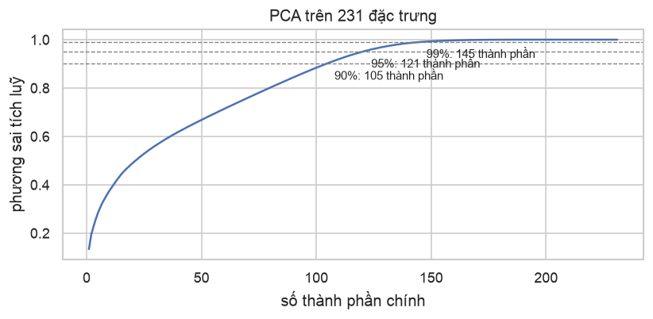

PCA **làm giảm** ROC-AUC của Logistic Regression (0,6433 → 0,6370 / 0,6320 / 0,6278 khi giữ 99% / 95% / 90% phương sai,
tương ứng 145 / 121 / 105 thành phần từ 231 đặc trưng): PCA giữ hướng có phương sai lớn, không phải hướng phân biệt churn.
Với k-NN, PCA không đổi kết quả. ⇒ Không dùng PCA trong cấu hình cuối.

### 5.5 Lựa chọn đặc trưng

| Cấu hình | Số đặc trưng | CV ROC-AUC ± std | CV PR-AUC | CV F1 | CV Accuracy |
|---|---|---|---|---|---|
| không chọn | 231 | 0.6433 ± 0.0018 | 0.6301 | 0.5939 | 0.6017 |
| ANOVA F, k=20 | 20 | 0.6069 ± 0.0041 | 0.6005 | 0.5607 | 0.5771 |
| ANOVA F, k=40 | 40 | 0.6222 ± 0.0033 | 0.6111 | 0.5742 | 0.5892 |
| ANOVA F, k=80 | 80 | 0.6397 ± 0.0009 | 0.6255 | 0.5933 | 0.6005 |
| mutual info, k=40 | 40 | 0.6304 ± 0.0019 | 0.6153 | 0.5828 | 0.5933 |
| L1 (C=0.05) | 158 | 0.6413 ± 0.0028 | 0.628 | 0.5917 | 0.6 |
| L1 (C=0.01) | 86 | 0.6389 ± 0.0012 | 0.6255 | 0.5928 | 0.6006 |

Không phương pháp nào vượt dùng đủ 231 đặc trưng. **L1** giữ 158 cột chỉ mất 0,0020 ⇒ khoảng 1/3 số đặc trưng gần như
không mang thêm thông tin (khớp đa cộng tuyến ở EDA). **ANOVA F** giảm mạnh khi k nhỏ vì chỉ đo quan hệ tuyến tính từng cột;
**mutual information** tốt hơn ANOVA F cùng k = 40 vì bắt được quan hệ phi tuyến. Cấu hình cuối không chọn đặc trưng.

### 5.6 So sánh mô hình

| Cấu hình | CV ROC-AUC ± std | CV PR-AUC | CV F1 | CV Accuracy |
|---|---|---|---|---|
| Baseline (Dummy) | 0.5000 ± 0.0000 | 0.4956 | 0 | 0.5044 |
| Logistic Regression | 0.6433 ± 0.0018 | 0.6301 | 0.5939 | 0.6017 |
| Linear SVM | 0.6394 ± 0.0028 | 0.6269 | 0.5799 | 0.6 |
| k-NN (k=25) | 0.5776 ± 0.0059 | 0.5731 | 0.5193 | 0.5546 |
| Gaussian Naive Bayes | 0.5781 ± 0.0081 | 0.564 | 0.3379 | 0.5363 |
| Random Forest | 0.6746 ± 0.0030 | 0.6608 | 0.6269 | 0.6217 |
| Gradient Boosting (Hist) | 0.6865 ± 0.0057 | 0.6742 | 0.6317 | 0.6322 |
| LightGBM | 0.6871 ± 0.0069 | 0.6745 | 0.6287 | 0.6316 |
| Logistic Regression (no class_weight) | 0.6433 ± 0.0018 | 0.6301 | 0.5876 | 0.6006 |
| Random Forest (no class_weight) | 0.6748 ± 0.0033 | 0.661 | 0.6218 | 0.6221 |
| Gradient Boosting (no class_weight) | 0.6865 ± 0.0045 | 0.6731 | 0.6277 | 0.6321 |

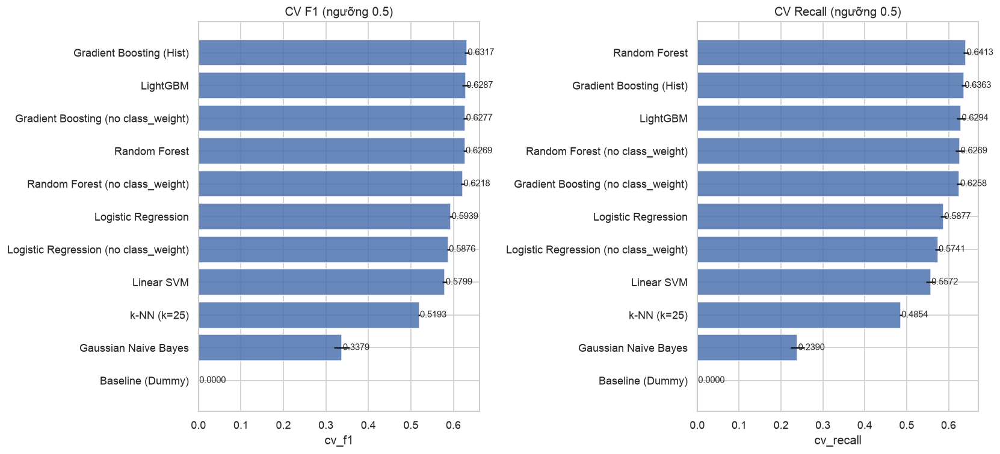

- **Mốc Dummy** (xác suất = tỷ lệ churn của train) có ROC-AUC 0,5 và F1 = 0 ở ngưỡng 0,5. Mọi mô hình đều vượt mốc.
- **Mô hình cây tăng cường vượt rõ mô hình tuyến tính**: LightGBM 0,6871 và Gradient Boosting 0,6865 (tương đương), Random
  Forest 0,6746, so với Logistic Regression 0,6433 — xác nhận quan hệ phi tuyến mà EDA gợi ý.
- k-NN và Gaussian Naive Bayes kém nhất: NB giả định đặc trưng độc lập và phân phối chuẩn — sai nặng với dữ liệu lệch và đa
  cộng tuyến.
- `class_weight="balanced"` không đổi ROC-AUC vì dữ liệu gần 50/50.

### 5.7 Kiểm định thống kê

| Câu hỏi | A | B | ROC-AUC A | ROC-AUC B | Chênh A − B | p (hiệu chỉnh) |
|---|---|---|---|---|---|---|
| Cờ giá trị thiếu có giúp? | cấu hình chọn (LR) | không cờ thiếu | 0.6437 | 0.64 | 0.0037 | 0.0003 |
| Log-transform có giúp? | cấu hình chọn (LR) | không log | 0.6437 | 0.6358 | 0.0079 | 0.0013 |
| Encoding có quan trọng? | cấu hình chọn (LR) | ordinal + target | 0.6437 | 0.6432 | 0.0005 | 0.8042 |
| PCA 95% có hại? | cấu hình chọn (LR) | PCA 95% | 0.6437 | 0.6344 | 0.0093 | 0.0045 |
| Lựa chọn đặc trưng có tác động? | cấu hình chọn (LR) | ANOVA F, k=40 | 0.6437 | 0.6197 | 0.024 | 0.0031 |
| GB hơn RF? | Gradient Boosting | Random Forest | 0.6884 | 0.6747 | 0.0137 | 0.0026 |
| GB hơn LR? | Gradient Boosting | cấu hình chọn (LR) | 0.6884 | 0.6437 | 0.0446 | < 0.0001 |

Có ý nghĩa (p < 0,05): cờ giá trị thiếu, log-transform, PCA 95% (làm giảm), ANOVA F k = 40 (làm giảm), Gradient Boosting hơn
Random Forest và hơn Logistic Regression. Không có ý nghĩa: cách encoding. LightGBM và Gradient Boosting chênh 0,0006 trên CV,
nhỏ hơn nhiều độ lệch chuẩn ⇒ coi là tương đương.

## 6. Tinh chỉnh siêu tham số

`RandomizedSearchCV` (3-fold, 5 tổ hợp mỗi mô hình) trên mẫu con 20.000 dòng của train; không gian tham số trong
`configs/default.yaml`. LightGBM giữ tham số cố định (1500 cây, learning rate 0,02, 31 lá, bagging 0,8, lấy mẫu cột 0,7).

| Mô hình | Tham số tốt nhất | CV ROC-AUC (20k) |
|---|---|---|
| Logistic Regression | C=0.1 | 0.6427 ± 0.0010 |
| Random Forest | n_estimators=150, min_samples_leaf=10, max_features=0.5, max_depth=10 | 0.6715 ± 0.0028 |
| Gradient Boosting (Hist) | min_samples_leaf=50.0, max_leaf_nodes=31.0, learning_rate=0.03, l2_regularization=1.0 | 0.6856 ± 0.0010 |

Tinh chỉnh cải thiện ít; với Logistic Regression C = 0,1 / 1 / 10 gần như bằng nhau ⇒ giới hạn nằm ở tín hiệu trong dữ liệu
hơn là ở siêu tham số.

## 7. Đánh giá cuối cùng trên tập test

Mỗi mô hình đã tinh chỉnh (và mốc Dummy) được fit lại trên **toàn bộ 80.000 dòng train**; ngưỡng phân loại chọn bằng xác suất
out-of-fold trên train; tập test 20.000 dòng chỉ dùng một lần.

### 7.1 Kết quả

| Mô hình (ngưỡng 0.5) | ROC-AUC | PR-AUC | Accuracy | Precision | Recall | F1 |
|---|---|---|---|---|---|---|
| LightGBM (mặc định) | 0.7049 | 0.6973 | 0.6448 | 0.6381 | 0.6542 | 0.646 |
| Gradient Boosting (Hist) (tuned) | 0.7008 | 0.6924 | 0.6417 | 0.6353 | 0.6502 | 0.6427 |
| Random Forest (tuned) | 0.6858 | 0.6774 | 0.6278 | 0.6185 | 0.6499 | 0.6338 |
| Logistic Regression (tuned) | 0.6507 | 0.638 | 0.6096 | 0.6079 | 0.5979 | 0.6028 |
| Baseline (Dummy) | 0.5 | 0.4956 | 0.5044 | 0 | 0 | 0 |

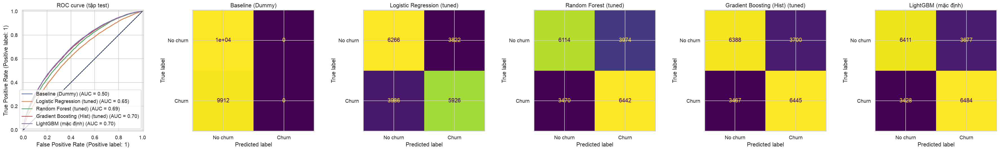

**LightGBM** — mô hình được chọn theo CV ở 5.6 — đạt **ROC-AUC 0,705, PR-AUC 0,697, accuracy 64,5%**, so với mốc Dummy 0,5 /
50,4%. Thứ hạng trên test khớp thứ hạng CV; điểm test cao hơn CV một chút do mô hình cuối học trên 80.000 dòng ⇒ không có dấu
hiệu overfit khi chọn cấu hình.

### 7.2 Chọn ngưỡng phân loại

| Mô hình | Quy tắc ngưỡng | Ngưỡng | Accuracy | Precision | Recall | F1 |
|---|---|---|---|---|---|---|
| Baseline (Dummy) | default | 0.5 | 0.5044 | 0 | 0 | 0 |
| Baseline (Dummy) | oof_balanced | 0.05 | 0.4956 | 0.4956 | 1 | 0.6627 |
| Baseline (Dummy) | oof_f1 | 0.05 | 0.4956 | 0.4956 | 1 | 0.6627 |
| Logistic Regression (tuned) | default | 0.5 | 0.6096 | 0.6079 | 0.5979 | 0.6028 |
| Logistic Regression (tuned) | oof_balanced | 0.49 | 0.6086 | 0.6008 | 0.6263 | 0.6133 |
| Logistic Regression (tuned) | oof_f1 | 0.34 | 0.5476 | 0.5245 | 0.9327 | 0.6714 |
| Random Forest (tuned) | default | 0.5 | 0.6278 | 0.6185 | 0.6499 | 0.6338 |
| Random Forest (tuned) | oof_balanced | 0.51 | 0.628 | 0.6273 | 0.6143 | 0.6207 |
| Random Forest (tuned) | oof_f1 | 0.37 | 0.5876 | 0.5508 | 0.9109 | 0.6865 |
| Gradient Boosting (Hist) (tuned) | default | 0.5 | 0.6417 | 0.6353 | 0.6502 | 0.6427 |
| Gradient Boosting (Hist) (tuned) | oof_balanced | 0.49 | 0.6415 | 0.6285 | 0.6765 | 0.6516 |
| Gradient Boosting (Hist) (tuned) | oof_f1 | 0.38 | 0.6082 | 0.5682 | 0.8727 | 0.6883 |
| LightGBM (mặc định) | default | 0.5 | 0.6448 | 0.6381 | 0.6542 | 0.646 |
| LightGBM (mặc định) | oof_balanced | 0.47 | 0.6438 | 0.6218 | 0.718 | 0.6665 |
| LightGBM (mặc định) | oof_f1 | 0.31 | 0.585 | 0.5482 | 0.9248 | 0.6884 |

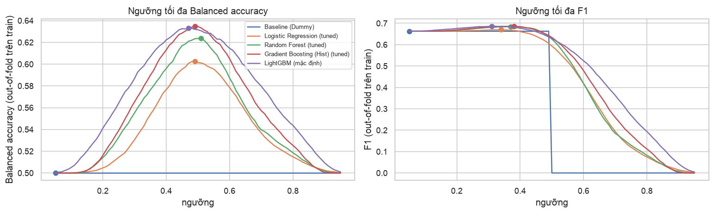

Ngưỡng tối đa **balanced accuracy** (≡ Youden J) nằm sát 0,5, đúng kỳ vọng với dữ liệu cân bằng: accuracy gần như giữ nguyên,
recall tăng nhẹ. Ngưỡng tối đa **F1** bị đẩy xuống 0,23–0,38: recall ≈ 0,9 nhưng accuracy tụt về 53–61%. Nguyên nhân: với 49,6%
churn, đoán "churn" cho mọi khách đã có F1 = 0,663 (dòng Dummy) — F1 của Logistic Regression ở ngưỡng F1 chỉ hơn mức tầm thường
này 0,009. Vì vậy báo cáo dùng ngưỡng balanced accuracy; trong thực tế ngưỡng nên chọn theo chi phí kinh doanh (giá một ưu đãi
giữ chân so với giá mất một khách hàng).

### 7.3 Mức quan trọng của đặc trưng

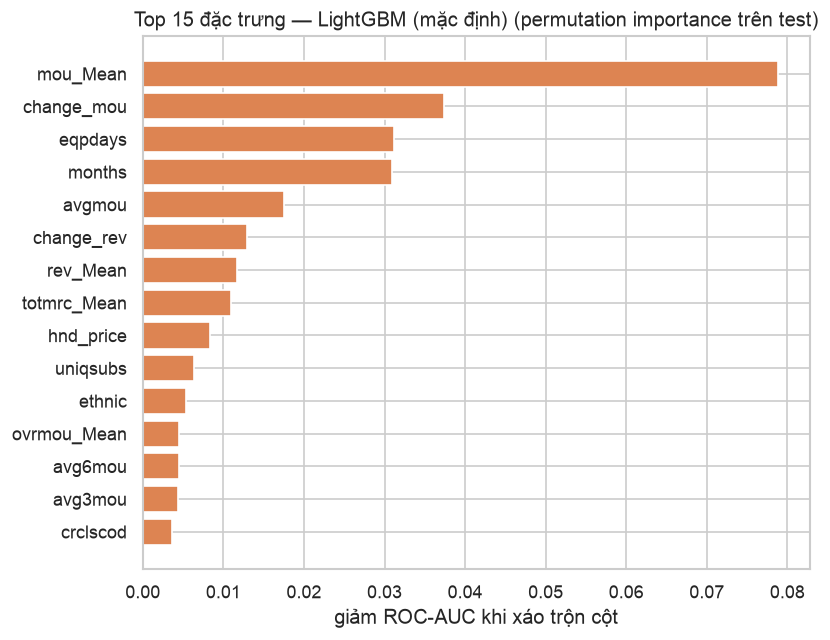

Permutation importance (giảm ROC-AUC khi xáo trộn cột, trên 5.000 dòng test) của LightGBM: `mou_Mean` (phút gọi trung bình),
`change_mou` (thay đổi phút gọi), `eqpdays` (tuổi thiết bị), `months` (thời gian sử dụng) quan trọng nhất; tiếp theo là
`avgmou`, `change_rev`, `rev_Mean` — các cột mà đặc trưng xu hướng được tạo từ đó.

### 7.4 Phân tích lỗi theo nhóm khách hàng

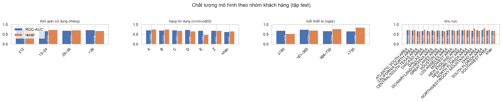

| Cách chia | Nhóm | n | Churn rate | Accuracy | Precision | Recall | ROC-AUC |
|---|---|---|---|---|---|---|---|
| thời gian sử dụng (tháng) | ≤12 | 6412 | 0.474 | 0.691 | 0.66 | 0.719 | 0.756 |
| thời gian sử dụng (tháng) | 13–24 | 8723 | 0.517 | 0.618 | 0.61 | 0.727 | 0.666 |
| thời gian sử dụng (tháng) | 25–36 | 3717 | 0.491 | 0.624 | 0.599 | 0.706 | 0.685 |
| thời gian sử dụng (tháng) | >36 | 1148 | 0.469 | 0.641 | 0.605 | 0.677 | 0.716 |
| hạng tín dụng (crclscod[0]) | A | 10920 | 0.514 | 0.644 | 0.629 | 0.747 | 0.706 |
| hạng tín dụng (crclscod[0]) | B | 3337 | 0.518 | 0.64 | 0.626 | 0.757 | 0.702 |
| hạng tín dụng (crclscod[0]) | C | 2011 | 0.464 | 0.645 | 0.602 | 0.69 | 0.706 |
| hạng tín dụng (crclscod[0]) | D | 898 | 0.421 | 0.676 | 0.606 | 0.659 | 0.727 |
| hạng tín dụng (crclscod[0]) | E | 1564 | 0.407 | 0.657 | 0.601 | 0.471 | 0.684 |
| hạng tín dụng (crclscod[0]) | Z | 833 | 0.511 | 0.634 | 0.63 | 0.69 | 0.685 |
| hạng tín dụng (crclscod[0]) | khác | 437 | 0.451 | 0.572 | 0.52 | 0.66 | 0.623 |
| tuổi thiết bị (ngày) | ≤180 | 3579 | 0.417 | 0.65 | 0.589 | 0.533 | 0.69 |
| tuổi thiết bị (ngày) | 181–365 | 7274 | 0.474 | 0.678 | 0.649 | 0.699 | 0.742 |
| tuổi thiết bị (ngày) | 366–730 | 7018 | 0.532 | 0.615 | 0.609 | 0.768 | 0.663 |
| tuổi thiết bị (ngày) | >730 | 2109 | 0.586 | 0.612 | 0.624 | 0.848 | 0.653 |

- **Thời gian sử dụng:** tốt nhất với khách ≤ 12 tháng (ROC-AUC 0,756), kém nhất ở 13–24 tháng (0,666) — nhóm đông nhất và
  churn cao nhất (51,7%).
- **Tuổi thiết bị:** máy trên 2 năm churn cao nhất (58,6%) nhưng ROC-AUC thấp nhất (0,653) — mô hình biết nhóm này rủi ro
  nhưng khó tách ai sẽ rời đi; máy 6–12 tháng phân biệt tốt nhất (0,742).
- **Hạng tín dụng:** hạng E có recall thấp nhất (0,47); nhóm hạng hiếm có ROC-AUC thấp nhất (0,623). Khu vực: ROC-AUC dao động
  hẹp 0,667–0,731.

## 8. Mở rộng: học sâu (MLP) so với pipeline truyền thống

Hai họ mạng nơ-ron nhiều tầng dùng cùng bộ tiền xử lý (StandardScaler, không PCA): **MLP sklearn** (Adam, early stopping) và
**MLP PyTorch** ([Linear → BatchNorm → ReLU → Dropout] × n, AdamW + BCE, dừng sớm theo loss validation, khôi phục trọng số tốt
nhất; bọc thành estimator sklearn nên dùng chung pipeline, CV và chọn ngưỡng).

| Cấu hình | CV ROC-AUC ± std | CV PR-AUC | CV F1 | CV Accuracy |
|---|---|---|---|---|
| MLP sklearn (64,) alpha=0.001 | 0.6365 ± 0.0042 | 0.6194 | 0.5844 | 0.5973 |
| MLP sklearn (128, 64) alpha=0.001 | 0.6299 ± 0.0023 | 0.6171 | 0.5992 | 0.5925 |
| MLP sklearn (128, 64) alpha=0.01 | 0.6275 ± 0.0078 | 0.616 | 0.5785 | 0.5875 |
| MLP sklearn (256, 128, 64) alpha=0.01 | 0.6324 ± 0.0079 | 0.6193 | 0.6146 | 0.596 |
| MLP PyTorch (128, 64) dropout=0.2 | 0.6423 ± 0.0046 | 0.6301 | 0.5806 | 0.5997 |
| MLP PyTorch (256, 128) dropout=0.3 | 0.6423 ± 0.0053 | 0.6307 | 0.5852 | 0.6033 |

| MLP (tập test) | Quy tắc ngưỡng | Ngưỡng | ROC-AUC | PR-AUC | Accuracy | Recall | F1 |
|---|---|---|---|---|---|---|---|
| MLP sklearn (best) | default | 0.5 | 0.6581 | 0.6485 | 0.6118 | 0.582 | 0.5977 |
| MLP sklearn (best) | oof_balanced | 0.5 | 0.6581 | 0.6485 | 0.6118 | 0.582 | 0.5977 |
| MLP PyTorch (best) | default | 0.5 | 0.6691 | 0.6579 | 0.6206 | 0.6017 | 0.6112 |
| MLP PyTorch (best) | oof_balanced | 0.47 | 0.6691 | 0.6579 | 0.6186 | 0.6666 | 0.634 |

- MLP PyTorch tốt hơn MLP sklearn cả trên CV và test: BatchNorm và dropout giúp ổn định khi đặc trưng lệch và đa cộng tuyến.
- Trên CV (30k) MLP PyTorch chỉ ngang Logistic Regression; trên test, học từ đủ 80k dòng, cả hai MLP hơn Logistic Regression
  ⇒ mạng nơ-ron cần nhiều dữ liệu hơn để khai thác quan hệ phi tuyến.
- Cả hai MLP **thua** LightGBM, Gradient Boosting và Random Forest — phù hợp nhận định phổ biến: với dữ liệu bảng cỡ vừa,
  nhiều biến lệch/đa cộng tuyến, mô hình cây tăng cường vẫn mạnh hơn mạng nơ-ron và ít tốn công chọn kiến trúc hơn.

## 9. Thảo luận

**Ưu điểm của pipeline.**
- Cấu hình được ở mọi bước; một `PipelineConfig` mô tả trọn một thí nghiệm, tái tạo được bằng một lệnh
  (`uv run churn --config configs/default.yaml`) hoặc *Run all* trên Colab.
- Không rò rỉ dữ liệu: mọi phép biến đổi có học tham số nằm trong `sklearn.Pipeline`; tập test chỉ dùng một lần.
- Kết luận dựa trên khác biệt đã kiểm định thống kê; quy tắc một sai số chuẩn tránh chọn phương án phức tạp vì nhiễu.

**Hạn chế.**
- Tín hiệu trong dữ liệu yếu (|r| ≤ 0,11); ROC-AUC tốt nhất ~0,70 — giới hạn nằm ở dữ liệu nhiều hơn ở mô hình.
- Thí nghiệm so sánh chạy trên mẫu con 30k và tuning trên 20k để vừa thời gian Colab; tham số LightGBM không được tinh chỉnh
  trong notebook.
- Ngưỡng chọn trên mẫu con 30k (mô hình mỗi fold học ~20k dòng) rồi áp cho mô hình học 80k dòng; với dữ liệu cân bằng, ngưỡng
  balanced accuracy ổn định quanh 0,5 nên ảnh hưởng nhỏ.
- Dữ liệu từ đầu những năm 2000, có thể không phản ánh hành vi khách hàng hiện nay.

**Hướng phát triển.** Đặc trưng riêng cho nhóm 13–24 tháng và khách có thiết bị cũ (lịch sử nâng cấp máy); chọn ngưỡng theo
ma trận chi phí thực tế; thử TabNet hoặc mô hình kết hợp (stacking) cây + MLP.

## 10. Kết luận

1. Pipeline truyền thống cấu hình được đã được đánh giá có hệ thống bằng CV trên train, với kiểm định thống kê cho các kết
   luận chính.
2. Tiền xử lý có tác động thật: cờ giá trị thiếu và biến đổi log trước khi scale. Encoding không tạo khác biệt; PCA và lọc
   đặc trưng theo ANOVA F làm giảm chất lượng.
3. Mô hình cây tăng cường quyết định độ chính xác: **LightGBM đạt ROC-AUC 0,705, accuracy 64,5%** trên test (mốc Dummy 0,5 /
   50,4%), hơn có ý nghĩa Random Forest, Logistic Regression và hơn cả hai MLP.
4. Với dữ liệu cân bằng, ngưỡng nên chọn theo balanced accuracy hoặc chi phí, không theo F1.

## 11. Sản phẩm nộp và hướng dẫn chạy

| Thư mục | Nội dung |
|---|---|
| `notebooks/` | `01-churn-pipeline.ipynb` — front-end Colab, chỉ gọi `modules/` và hiển thị |
| `modules/` | package Python: `datasets`, `preprocessing`, `featurize`, `modeling`, `evaluation`, `reporting`, `experiments`, `app`, `shared` |
| `reports/` | `figures/` (14 hình), `results/` (bảng CSV mọi thí nghiệm), báo cáo này |
| `features/` | đặc trưng sau tiền xử lý (fit trên train) dạng `.npy` + `meta.json` |

Đặc trưng đã lưu (`X_train.npy`, `X_test.npy`, `y_train.npy`, `y_test.npy`):

| Biến thể | Dùng cho | X_train | X_test |
|---|---|---|---|
| `best_linear` | Logistic Regression, SVM, MLP | (80000, 234) | (20000, 234) |
| `best_tree` | Random Forest, Gradient Boosting, LightGBM | (80000, 234) | (20000, 234) |
| `pca95` | giảm chiều (PCA 95% phương sai) | (80000, 122) | (20000, 122) |

**Chạy trên Colab:** mở link Colab ở trang bìa → *Runtime → Run all*. Cell đầu tự `git clone` mã nguồn và
`pip install -r requirements.txt`; dữ liệu tự tải từ link Kaggle công khai và giải nén vào `data/raw/`; không mount Google
Drive. Thời gian chạy: 17–22 phút trên máy 10 nhân; Colab (2 CPU) có thể lâu hơn — giảm `stage_sample` / `tuning.sample` trong
`configs/default.yaml` nếu cần.

## 12. Phân công công việc và tỷ lệ đóng góp

| Thành viên | Công việc | Tỷ lệ hoàn thành |
|---|---|---|
| `<Thành viên 1>` | `<EDA, tiền xử lý, …>` | `<%>` |
| `<Thành viên 2>` | `<mô hình, thí nghiệm, …>` | `<%>` |
| `<Thành viên 3>` | `<báo cáo, MLP, …>` | `<%>` |

Minh chứng làm việc nhóm (ảnh/video họp, biên bản): `<link thư mục minh chứng>`.
